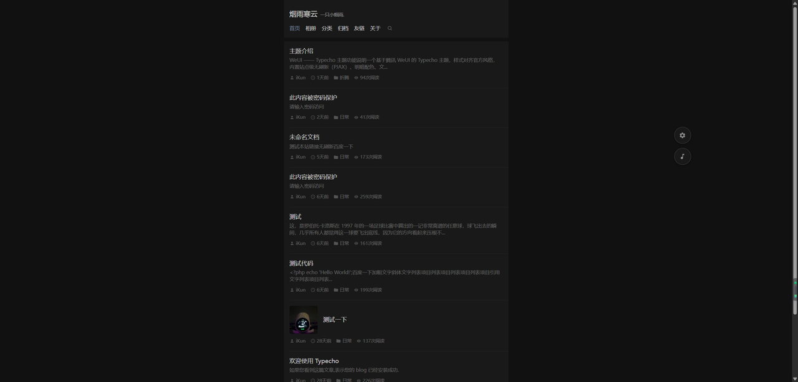

# WeUI —— Typecho 主题

> 基于腾讯 [WeUI](https://weui.io) 开发的 Typecho 主题，整体样式对齐微信官方风格。

站点级无刷新跳转、明暗双配色、评论富文本与无刷新回复、文章目录、相册、点赞打赏分享，
以及一个**自研的完整音乐播放器**（歌词逐字跟唱）。

作者：**烟雨寒云** · 演示站点：<https://yyhy.me/>



---

## 特性一览

**全站无刷新（PJAX）**
点站内链接由 `fetch` 接管，只换内容区并同步标题与地址栏；前进后退正常，换页后自动重新初始化懒加载、灯箱、代码高亮、目录。返回顶部按钮和音乐播放器放在容器之外，**换页不会重建、播放不中断**。第三方统计只在首次整页加载执行一次，之后每次换页由主题按各平台标准接口补发一次浏览。

**明暗双配色**
颜色全部走 WeUI 的 CSS 变量，自动适配。三种模式：跟随系统（实时响应）、按时间自动（可设亮色区间，支持跨夜）、手动锁定。侧边齿轮可切换，选择记在本地；`<head>` 内尽早定色，刷新不闪白。

**文章阅读体验**
相对时间（点击可切换成完整时间）、阅读次数（可按访客去重）、文章目录（标题 ≥ 2 才出现，滚动高亮当前章节，面板宽度自适应）、代码高亮并自带复制按钮、图片懒加载与灯箱、外链自动新窗口、无封面视频自动抽帧当封面。

**评论区**
无刷新提交与回复，支持**分页 / 按钮加载更多 / 瀑布流加载更多**三种方式；富文本编辑器 + 贴纸表情；回复时自动插入 `@某某`（可点击定位并高亮）；评论点赞；评论框位置可放在列表上方或下方；提交后精准定位并高亮新评论。

**音乐播放器**
自研 HTML5 播放器（不依赖 APlayer）：列表循环 / 随机 / 单曲循环、进度条拖动、封面列表与当前项自动定位、**记住上次播放位置**、跨标签页互斥出声、加载失败自动跳过。歌词为贴底单行，**逐字扫过高亮**，支持超长行横向滚动与 **`男：/女：/合：` 分色**。

**相册**
文章标记 `album=1` 后自动切换成相册布局：正方形网格（移动端 3 列 / PC 4 列）+ 灯箱，支持视频格子。

**点赞 / 打赏 / 分享**
文章点赞（可取消，本地记忆）；打赏支持微信 / 支付宝二维码（都填则并排，都空则隐藏）；分享面板含微博、QQ 空间、Telegram、微信扫码、复制链接、**生成海报**（纯前端 canvas 绘制，可下载或长按保存）。

**其他**
友链页、归档时间线、分类页、关于页、密码保护文章无刷新解锁、`` 图片随明暗自动换源、侧边悬浮按钮（移动端贴边半圆片 / PC 按黄金分割定位的悬浮球）。

> 每一项的完整说明（含全部后台设置项）见 [`FEATURES.md`](FEATURES.md)。

---

## 环境要求

| 项 | 要求 |
| --- | --- |
| Typecho | **1.2 及以上**（主题使用命名空间 API，如 `\Widget\Options`） |
| PHP | 7.4+，推荐 8.x |
| 数据库 | MySQL / MariaDB（Typecho 支持的其他库同样可用） |

- **不依赖任何外网 CDN**：WeUI 样式子集、highlight.js、Fancybox、qrcode 都已放进 `assets/`
- 唯一的第三方 PHP 库是 `libs/Meting.php`（音乐播放器取址用）
- `cache/` 目录用于音乐接口的本地缓存，**需要可写**；不可写时会静默降级为直连

---

## 安装

**方式一：git 克隆（推荐，便于更新）**

```bash
cd /path/to/typecho/usr/themes
git clone https://github.com/YanYuHanYun/typecho-weui.git weui
```

**方式二：下载压缩包**

从 [main 分支压缩包](https://github.com/YanYuHanYun/typecho-weui/archive/refs/heads/main.zip) 下载后解压，把目录放进 `usr/themes/`。

然后：

1. 后台 → **控制台 → 外观** → 启用 **WeUI**
2. 后台 → **控制台 → 外观 → 设置外观**，按需配置（见下）
3. 建议给缓存目录写权限：`chmod 755 usr/themes/weui/cache`

> 主题信息（名称 / 作者 / 版本）由 `index.php` 头部的注释读取，**不需要 `info.json`**。

---

## 主题设置

位置：**后台 → 控制台 → 外观 → 设置外观**。

### 头部与外观

| 设置项 | 说明 |
| --- | --- |
| 网站头部位置 | 跟随页面滚动 / 固定在页面顶部 |
| 首页显示副标题 | 是否在首页头部显示站点副标题 |
| 头部搜索 | 开启后导航栏右侧出现搜索按钮，点击展开搜索栏 |

### 配色

| 设置项 | 说明 |
| --- | --- |
| 显示明暗模式切换按钮 | 关闭后前台不再显示切换齿轮，访客一律按「默认配色」 |
| 默认配色 | 跟随系统 / 按时间自动 / 亮色 / 暗色 |
| 亮色起始小时、结束小时 | 「按时间自动」的区间（0–23 整点，支持跨夜） |

### 头像

| 设置项 | 说明 |
| --- | --- |
| Gravatar 头像加速地址 | 留空用官方；可填镜像（如 `https://cn.cravatar.com`），主题会自己补 `/avatar/<hash>` |

### 底部

| 设置项 | 说明 |
| --- | --- |
| 页脚自定义内容 | 支持 HTML，显示在版权信息**上方**（备案号、友链等） |
| 统计代码 | 第三方统计脚本，只在首次整页加载执行；无刷新换页时由主题补发 |
| 建站年份 | 页脚版权显示为 `建站年份-当前年份`；留空只显示当前年份 |

### 列表与评论

| 设置项 | 说明 |
| --- | --- |
| 列表翻页方式 | 分页 / 按钮加载更多 / 瀑布流加载更多 |
| 评论翻页方式 | 同上（需先在「设置 → 评论」里开启评论分页） |
| 评论框位置 | 评论列表上方 / 下方 |
| 文章点赞 | 是否显示文章点赞按钮 |
| 文章分享 | 是否显示分享按钮 |
| 评论点赞 | 是否在每条评论上显示点赞 |
| 阅读计数方式 | 按访客去重 / 每次访问都计数 |

### 打赏

| 设置项 | 说明 |
| --- | --- |
| 微信打赏二维码 | 图片地址；留空则不显示微信打赏 |
| 支付宝打赏二维码 | 两个都填则并排显示 |
| 打赏说明文字 | 显示在二维码上方，可留空 |

### 音乐播放器

| 设置项 | 说明 |
| --- | --- |
| 音乐播放器 | 开启后侧边出现音乐按钮 |
| 音乐平台 | 网易云 / QQ 音乐 / 酷狗 / 百度音乐（要与歌单 ID 对应） |
| 歌单 ID / 链接 | 一行一个，支持纯 ID 或分享链接 |
| 网易云 Cookie、QQ 音乐 Cookie | 留空用内置兜底；失效时填自己的 Cookie |
| 音乐接口密钥 | 给代理地址签名防盗刷，留空用默认值 |
| 自动播放 | 打开页面自动播放（可能被浏览器策略拦截） |
| 默认显示歌词 | 歌词条的初始状态，前台仍可自行开关并记住 |
| 默认播放模式 | 列表循环 / 随机播放 / 单曲循环 |

---

## 页面模板

新建独立页面时，右侧「**自定义模板**」可选：

| 模板 | 用途 |
| --- | --- |
| 归档 | 按年月分组的归档时间线 |
| 分类 | 列出全部分类及文章数 |
| 相册 | 相册文章列表 |
| 友链 | 正文按约定格式解析成友链网格 |
| 关于 | 通用图文页（带评论区） |

---

## 文章自定义字段

编辑文章时在「自定义字段」里填：

| 字段 | 值 | 说明 |
| --- | --- | --- |
| `album` | `1` | 标记为相册文章，自动切换到相册布局 |
| `thumbnail` | 图片地址 | 列表缩略图，留空自动取正文首图 |

计数用的字段（`views`、`likes`、`comment_likes`）已在编辑页隐藏，避免编辑文章时被误清零。

---

## 用法示例

### 友链页

「友链」模板会把正文逐行解析成友链卡片，每行四个字段用 `|` 分隔：

```
名称|https://example.com|https://example.com/avatar.png|一句话介绍
```

图片字段可以留空，会显示名称首字。

### 相册

1. 新建文章，正文按正常方式插入图片（视频也行，用附件或外链都可以）
2. 在该文章的「自定义字段」里加 `album` = `1`
3. 保存后打开就是相册布局；图片说明取 `alt`，视频取 `title` / `alt` / `data-caption`

### 图片随明暗自动切换

给任意 `` 写两个属性即可，不需要 JS：

```html

```

浅色主题显示 `light-src`，深色主题显示 `dark-src`；只写其中一个时互相回退。运行时动态插入的图片（含无刷新换页新增的）也会自动适配。

### 打赏

在后台「设置外观 → 打赏」里填二维码图片地址。两个都填会并排显示，只填一个则居中，都留空整块不出现。

---

## 目录结构

```
weui/
├── assets/
│   ├── weui.css              # WeUI 样式子集（从官方 dist 逐条摘录的最小集）
│   ├── theme.js              # 主题的全部前端交互
│   ├── highlight.min.js/.css # 代码高亮（配色跟随明暗）
│   ├── fancybox.umd.js/.css  # 图片灯箱
│   ├── qrcode.min.js         # 分享二维码
│   └── emoticons/            # 贴纸 149 张 + 表情 44 个（含 manifest.json）
├── libs/
│   └── Meting.php            # 音乐取址核心库（Meting 1.5.7）
├── cache/                    # 音乐接口本地缓存（运行时生成，不进版本库）
├── index.php                 # 文章列表（首页）+ 通用归档
├── post.php                  # 文章详情；相册文章自动切换布局
├── page.php                  # 独立页面
├── archive.php               # 通用归档（标签 / 作者 / 日期）
├── category.php              # 分类归档
├── search.php                # 搜索结果
├── archives.php              # 模板：归档（时间线）
├── categories.php            # 模板：分类
├── gallery.php               # 模板：相册列表
├── gallery_album.php         # 相册详情
├── links.php                 # 模板：友链
├── about.php                 # 模板：关于
├── header.php / footer.php   # 页头、页脚
├── comments.php              # 评论区
├── functions.php             # 主题函数、后台设置项、各类钩子
├── style.css                 # 主题自有样式
├── screenshot.png            # 主题预览图
├── FEATURES.md               # 完整功能说明
└── README.md
```

---

## 常见问题

**Q：启用后样式错乱 / 功能不生效？**
确认 Typecho 版本 ≥ 1.2。主题用了命名空间 API，1.1 及更早版本不兼容。

**Q：音乐播放器放不出声？**
网易云和 QQ 音乐取播放地址需要 Cookie，后台可填自己的；内置兜底 Cookie 会失效，失效时换成自己的即可（浏览器登录后从开发者工具里复制）。另外缓存目录要可写。

**Q：评论提交后提示「等待审核」？**
这是 Typecho 的审核设置决定的。主题的做法是：**待审核的评论对提交者本人可见**（带「待审核」小标签），别人看不到。管理员在自己站点评论会直接通过、不显示该标签。

**Q：评论的「加载更多」和分页模式怎么选？**
后台「设置外观 → 评论翻页方式」。注意要先在 Typecho 的「设置 → 评论」里开启评论分页，否则三种方式都没有可翻的内容。

**Q：换了主题目录名有影响吗？**
没有。主题信息从 `index.php` 头部注释读取，目录名随意。

---

## 致谢

- [WeUI](https://weui.io) —— 腾讯微信官方设计语言
- [highlight.js](https://highlightjs.org/) —— 代码高亮
- [Fancybox](https://fancyapps.com/fancybox/) —— 图片灯箱
- [qrcode.js](https://github.com/davidshimjs/qrcodejs) —— 二维码生成
- [Meting](https://github.com/metowolf/Meting) —— 音乐接口

## 许可

主题内使用的第三方资源（WeUI、highlight.js、Fancybox、qrcode.js、Meting）版权归各自作者所有，遵循其原始协议。

主题自身的代码由 **烟雨寒云** 编写与维护。如需转载或二次分发，请保留作者信息。
